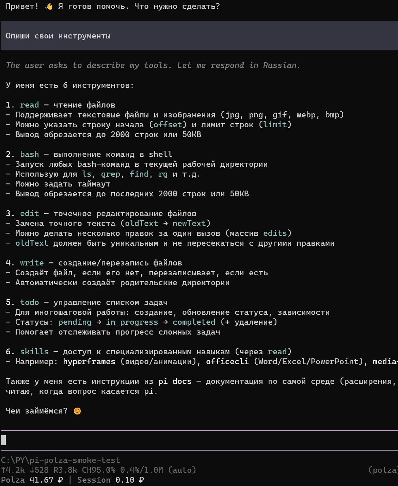
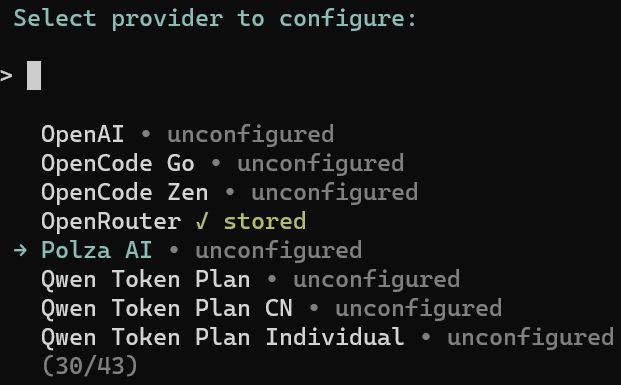
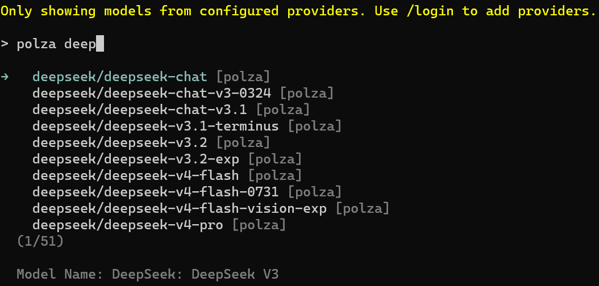
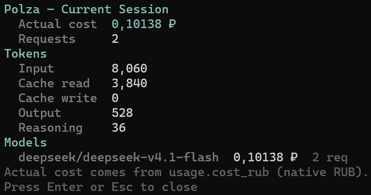
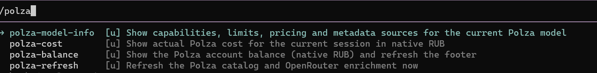
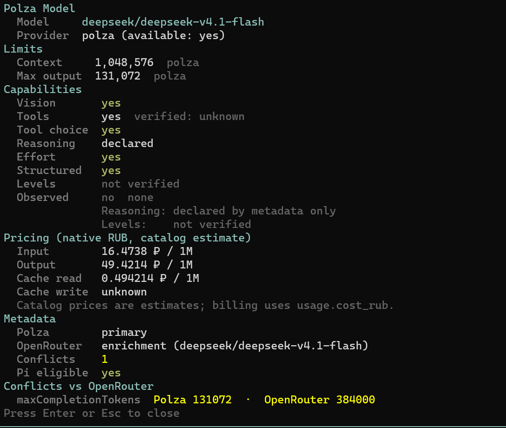
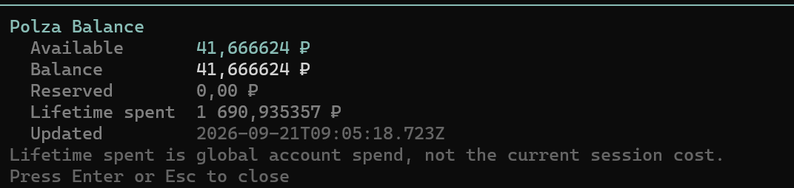

# pi-polza

English · [Русский](README.md)

**Polza AI as a native dynamic provider for [Pi Agent](https://pi.dev) — hundreds of models, native Pi login, and actual RUB billing.**

`pi-polza` plugs [Polza AI](https://polza.ai) into Pi as a real model provider. Install it once,
sign in with your Polza API key through Pi, pick a model and work normally. The plugin discovers
the available models and their capabilities dynamically, and tracks Polza's own spending in rubles
right in Pi's footer.



## Why

Polza exposes an OpenAI-compatible endpoint, but a plain endpoint tells Pi nothing about *which*
models exist, what their limits are, or what a request actually cost. This plugin fills that gap:

- the catalog is **discovered at runtime**, not hard-coded;
- authentication is **native Pi `/login`**, so your key lives in Pi's own credential store;
- money is tracked in **RUB**, the currency Polza actually bills in.

## Features

- Dynamic Polza model catalog (loaded at startup, refreshable in place)
- Native Pi `/login` authentication — no config files required
- Hundreds of compatible LLMs from a single provider
- Context-window and max-output limits
- Vision / tools / reasoning metadata, with honest `unknown`
- OpenRouter metadata enrichment (limits, modalities, capabilities)
- Actual `usage.cost_rub` accounting — Polza's own number, not an estimate
- Subagent cost accounting: foreground automatically, background on run completion
- Account balance and session cost in Pi's footer
- Streaming responses and tool calling
- Four slash commands for inspecting models, cost and balance

The reasoning level is picked with Pi's own controls — `/thinking` in a session or `--thinking` at
startup. `xhigh` and `max` are available only on models where the Polza catalog declares reasoning
levels (a published allow-list or a declared `reasoning_effort`); for the rest the set stays within
`off…high`.

## Installation

Requires [Pi Agent](https://pi.dev) ≥ 1.0.2 (< 2.0.0), Node.js ≥ 22.19.0, and Git for GitHub installation. Other packages in a build may require a newer Node. The provider needs no Python. For ready-made Code/Task profiles use the [build installer](https://github.com/VladimirMonin/pi-agent-build/blob/main/INSTALL_FOR_AGENTS.md), not a local checkout override of its pin.

### Historically verified compatibility

**pi-polza 0.2.2 + Pi Agent 1.4.0:** Windows checks exercised the real lifecycle with synthetic HTTP: persisted login → cold start without env/cache → catalog before main-model selection, restart, and material failures. This is not live Polza or fresh visual TUI acceptance. The minimum API version does not qualify every intermediate release.

**pi-polza 0.2.1 + Pi Agent 1.3.0** were checked on **Windows / Node.js 25.8.1**:
the unchanged provider code ran with Pi's real native transport and synthetic SSE responses.
Checks covered reasoning, tool-argument JSON assembly, usage, completion at `[DONE]` before
delayed EOF, and exactly-once accounting of actual `usage.cost_rub` separately from USD
(the USD `cost` stays `0`). This verifies the runtime contract; it is **not** a new live Polza
service test or user acceptance on Pi 1.3.0.
See the [compatibility evidence note (Russian)](notes/pi-1.3.0-compatibility.md) for scope and limits.

Previously, the native RUB accounting fix in **v0.2.1** was checked with Pi Agent **1.0.2**;
the owner confirmed the installed fix works in a new session. That historical user acceptance
remains separate from the synthetic Pi 1.3.0 check.
Compatibility with every 1.x version, every model, or a full live workflow is not claimed.

```bash
pi install https://github.com/VladimirMonin/pi-polza
```

For a fixed source, substitute an **already published** tag or commit:

```bash
pi install "https://github.com/VladimirMonin/pi-polza@v0.2.2"
```

Verify it is installed:

```bash
pi list
```

## Authentication

Start Pi and run `/login`:

```
/login
```

1. Choose **Polza AI**.
2. Choose **Sign in with an API key**.
3. Paste your Polza API key.



The key is stored by Pi itself (the same place as every other provider) and is used for the model
catalog, chat requests and balance lookups. No `.env` file is needed.

> The main `polza` catalog must be available before a working request. If it is empty, `/polza-refresh` helps diagnosis but does not establish a successful cold start. Distinguish missing/rejected credentials, network failure, and an unavailable model ID; do not make `.env` mandatory instead of checking native auth.

Select a model with `/model` and inspect `/polza-model-info`: the provider must be **`polza`**. A separate `polza-memory` route in some builds serves consolidation; memory embeddings and session-search are configured independently. A successful service-model response does not establish main-agent readiness. [Install and cold-start checks (Russian)](instructions/manual-testing.md).

### Advanced: environment / headless / CI

For headless or CI use you can supply the key through the environment instead of `/login`:

| Variable | Meaning |
| --- | --- |
| `POLZA_API_KEY` | The key itself. |
| `PI_POLZA_ENV_FILE` | Path to a specific `.env` file to read. |

Otherwise, a `.env` file in the project you launch Pi from is read:

```dotenv
POLZA_API_KEY=<your-key>
```

A stored Pi credential always wins; the environment is only consulted when nothing is stored.

## Quick start

```
/login            → Polza AI → Sign in with an API key
/model            → search "polza" → pick any model
<ask anything>
```



## Models

The catalog is fetched dynamically from Polza; metadata enrichment is cached. The selectable chat-model count changes: non-chat entries and models without reliably known mandatory limits are filtered out (see [Known limitations](#known-limitations)). A fixed count is not a readiness criterion.

`/polza-refresh` reloads the catalog and the OpenRouter enrichment without restarting Pi.

## RUB billing

Polza bills in rubles, and Pi's own cost field is denominated in USD. `pi-polza` therefore keeps
native RUB accounting **separate** from Pi's USD `cost`:

| Source | Used for |
| --- | --- |
| Catalog pricing | A reference estimate (₽ per 1M tokens) |
| `usage.cost_rub` | The **actual** amount Polza charged for the request |
| `GET /api/v2/balance` | The account balance |

Session cost is recorded once from the last `usage.cost_rub` after a successful response.
Pi's native observer snapshots the value before normalization without buffering the HTTP stream;
accounting does not wait for it to close after `[DONE]`. The total survives a restart.
Missing or malformed costs, errors and aborted responses stay unknown; a genuine zero is preserved.
If a balance refresh fails, the footer retains the last amount with a `stale` marker;
a successful refresh clears it.

> The plugin does **not** estimate actual session spending from token prices. It records Polza's own
> `usage.cost_rub` value returned for each request. Catalog prices are shown only as an estimate.



Pi's standard USD `cost` field is intentionally left at `0` — native RUB numbers are never written
into it.

## Subagents and background tasks

Pi can run subagents (for example through `pi-subagents`). `pi-polza` accounts for their spending
separately from the main session:

| Subagent kind | How it is accounted |
| --- | --- |
| Foreground | Automatically: it inherits the parent's provider, so its requests land in the main session as usual. |
| Background | On completion: it runs in a detached process with its own `pi-polza` instance, so its spending is imported into the main session once the run has finished. |

**What counts.** Only real Polza responses carrying `usage.cost_rub`: requests from the main
session, from foreground subagents and from completed background subagents. That is the only source
of the totals.

**When it updates.** Main and foreground — on every completed request; background — after the run
completes. While a background run is still in flight its spending may not be included yet; that is
an honest state, not zero.

**What does not count.** Other providers (Anthropic, OpenAI, …); independent sessions of other
users or peers, even when they share the same Polza account; external API clients that reach Polza
outside `pi-polza`. Foreign spend is never converted to RUB and **never shown as `0 ₽`** — it is
simply excluded from the report.

**Where to look.** Pi's footer (`Polza <balance> ₽ | Spent <cost> ₽`) and `/polza-cost`.
`/polza-balance` shows the **whole account wallet**, not session cost: the balance also moves
because of other sessions and applications, so its delta is not a measure of one run.

**Attribution limitation.** Foreground subagents contribute their amount but not their agent name.
Their requests are indistinguishable from the main agent's (especially with matching models and
parallel children), so the plugin does not guess an owner. In `/polza-cost` they are part of
`Root session` — the total is correct, the attribution is not available.

**When data is incomplete.** With incomplete data the footer appends a `partial` marker and
`/polza-cost` gains a `Coverage` section with priced/unpriced request counts. An unknown cost stays
unknown and never becomes `0 ₽`.

> The `pi-subagents` integration is **optional**. If the package is not installed, `pi-polza`
> behaves as before: nothing is discovered and no errors are shown.

## Commands

| Command | Description |
| --- | --- |
| `/polza-model-info` | Capabilities, limits, pricing, metadata sources and catalog reasoning levels (`Catalog levels` row) for the current model |
| `/polza-cost` | Actual Polza cost: main session, foreground and completed background subagents |
| `/polza-balance` | Polza account balance (native RUB) and footer refresh |
| `/polza-refresh` | Reload the Polza catalog and OpenRouter enrichment now |

### What `/polza-cost` shows

The report is split into sections:

- **Root session** — main session plus foreground subagents (the total is correct, per-agent
  attribution is not available);
- **Background subagents** — completed background children, grouped by the agent name and model the
  launch runtime reported;
- **Tokens** and **Models** — token and cost breakdown by model;
- **Coverage** — how many requests have a known cost versus an unknown one, with a
  `complete` / `partial` marker;
- **Not included** — foreign providers, explicitly excluded from RUB accounting.

<details>
<summary>Command screenshots</summary>

**Command discovery**



**`/polza-model-info`**



**`/polza-balance`**



</details>

## Model metadata

Metadata is resolved from several sources, in priority order:

1. **Polza** — primary source of truth (the model exists and is billable).
2. **OpenRouter** — enrichment only: limits, modalities and capabilities when Polza does not
   state them. Matched by exact model id; never guessed.
3. **Verified override** — a rare, explicit correction backed by a live probe.
4. **`unknown`** — when none of the above provides a trustworthy value.

Because of this, fields can read `unknown` or `not verified`. That means **there is no reliable
confirmation**, not that the plugin failed. The plugin never invents capabilities to fill a gap:
an absent value stays `unknown`, never `0`.

The `Catalog levels` row in `/polza-model-info` lists the levels Pi will offer for the current model
according to the catalog; it reads `unknown` when the catalog declares no reasoning levels.

<details>
<summary>Screenshot: metadata detail</summary>


</details>

## OpenRouter enrichment

OpenRouter's public model list is used to fill gaps in limits, modalities and capabilities. It is
treated strictly as enrichment:

- matched by **exact model id** only;
- a Polza value always wins over an OpenRouter value;
- disagreements are recorded as **conflicts** and surfaced in `/polza-model-info`;
- results are cached on disk (`.pi/pi-polza-cache/`) and reused offline, so a slow or unavailable
  OpenRouter never blocks startup.

## Known limitations

- Reasoning *levels* come from the catalog, not from guesses: a published allow-list
  (`top_provider.reasoning.supported_efforts`) exists for 85 of 300 chat models and `xhigh` is
  declared for 44 of them; `reasoning_effort` is declared for 187 of 300. Levels absent from a
  published list are hidden, and `xhigh`/`max` appear only where the catalog declares reasoning
  levels; with no list but a declared `reasoning_effort`, Pi level names pass through unchanged and
  `off` is hidden. Whether the selected level changes a live request is not verified, so the panel
  still reports `not verified` where we have no reproducible evidence.
- Some Polza-exclusive models are omitted when mandatory Pi model limits cannot be determined
  reliably — better absent than wrong.
- Catalog metadata and the actually billed cost can differ. Billing always follows `usage.cost_rub`.
- Pi's standard USD `cost` field is not used for native RUB accounting.
- Metadata completeness varies by model; not every model has equally rich information.
- Foreground subagents have no per-agent breakdown: their spending is part of the main session
  total because it is indistinguishable from the main agent's own requests.
- Background subagent import is verified by offline tests; a full live run with background
  subagents in a real Pi environment is out of scope for this version.

## Updating

For a floating Git source, Pi uses `pi update <source>` (check `pi update --help` for your version). Tag/commit-pinned installs move to an explicitly selected **published ref**:

```bash
pi install "https://github.com/VladimirMonin/pi-polza@v0.2.2"
```

A local `pi install "<REPO_ROOT>"` reads the working tree; it does not prove GitHub delivery. Do not load local and Git copies together. In an accepted build, its installer updates the provider from the manifest, not an unpinned bulk update. [Source differences (Russian)](instructions/manual-testing.md).

## Uninstalling

```bash
pi remove https://github.com/VladimirMonin/pi-polza
```

This removes the package from Pi settings. Pi's stored Polza credential can be removed separately
via `/login` (or Pi's credential management).

## Development

```bash
npm test            # offline unit tests
npm run test:live   # live tests (needs a key; spends a small amount)
npm run probe:catalog
npm run probe:balance
npm run probe:chat
npm run probe:startup
npm run audit:secrets
```

Start a small fix with affected checks. A full offline suite belongs at the agreed release boundary or a broad-impact change; a live experiment resolves material external-contract uncertainty. Check TUI behavior when an interactive path changes, not after every link edit. Reuse applicable previous results with their original version and scope.

Repository layout:

- `.pi/extensions/pi-polza/` — the extension: runtime code and shared modules
- `scripts/` — standalone diagnostic probes
- `tests/`, `tests-live/` — offline and live tests
- `notes/` — engineering notes and live-experiment results
- `instructions/manual-testing.md` — how to prepare and run an install acceptance test
- `instructions/commit-and-release-guide.md` — commit, tag and release conventions

## Security

- `POLZA_API_KEY` is never logged — not to stdout/stderr, traces, session logs or errors.
- The `Authorization` header is stripped before any HTTP logging.
- `.env` is git-ignored; `.env.example` shows the expected shape.
- The plugin stores no credential of its own — it uses Pi's native credential store.
- `npm run audit:secrets` scans the working tree and Git history for leaked secrets.

## Related projects

- [Pi Agent Build](https://github.com/VladimirMonin/pi-agent-build) — a version-pinned Code/Task build with an installer and guarded patches; its manifests/release notes own versions and acceptance.
- [Project Foundation Kit](https://github.com/VladimirMonin/Project-Foundation-Kit) — portable engineering methods, instructions, and templates. Adopt the full `pack/` separately; the provider does not install it automatically.

## License

[MIT](LICENSE)
